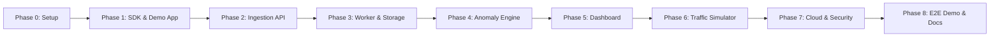

# 🚀 Project Roadmap & Execution Phases

## Cloud-Based Web Application Monitoring & Anomaly Detection Platform

This document outlines the step-by-step phased execution plan for building the entire monitoring and anomaly detection platform from scratch to final AWS deployment and demonstration.

---

---

## 📌 Summary of Phases

| Phase | Title | Focus Area | Deliverables |
| :--- | :--- | :--- | :--- |
| **Phase 0** | **Project Setup & Architecture** | Workspace structuring, DB schema, config setup | Monorepo layout, shared types/schemas, docker-compose for local dev |
| **Phase 1** | **SDK & Demo Application** | Client telemetry & target application | Lightweight npm SDK middleware, sample E-Commerce target app |
| **Phase 2** | **Monitoring API (Ingestion)** | API authentication & queuing | Telemetry ingest endpoint, API key auth, SQS publisher, dashboard APIs |
| **Phase 3** | **Worker Pipeline & Storage** | Async processing, S3 & RDS persistence | SQS consumer, S3 raw logger, RDS structured DB storage, metrics aggregator |
| **Phase 4** | **Anomaly Detection Engine** | Baseline computation & anomaly detection | Threshold detector, statistical (Z-score) engine, incident generation |
| **Phase 5** | **Monitoring Web Dashboard** | Frontend visualization | Live application dashboard, latency/error charts, incident panel |
| **Phase 6** | **Traffic Simulator & Chaos Testing** | Synthetic load generation | Scenario simulator (Normal, High Latency, 5xx Spikes, Login Attack) |
| **Phase 7** | **AWS Cloud Deployment & Security** | Cloud infrastructure & hardening | EC2, SQS, S3, RDS, IAM Least Privilege, Security Groups, CloudWatch |
| **Phase 8** | **E2E Testing, Demo & Final Report** | System verification & presentation | Full pipeline demo rehearsal, stress testing, documentation & presentation |

---

## 🔹 Phase 0: Project Setup & Local Environment

### 🎯 Goal:
Set up the workspace foundation, monorepo structure, local development environment, and database schemas.

### 📋 What we will do (Kya karenge):
1. **Repository Structure**:
   - Create directories: `sdk/`, `monitoring-api/`, `worker/`, `dashboard/`, `demo-app/`, and `traffic-simulator/`.
2. **Local Development Setup**:
   - Configure local PostgreSQL/MySQL database and LocalStack / mock queue for local development before deploying to AWS.
   - Set up root `package.json` with workspace scripts (`npm run dev:api`, `npm run dev:worker`, etc.).
3. **Database Schema Design**:
   - Define SQL tables for `applications`, `api_keys`, `telemetry_logs`, `metrics`, and `incidents`.
   - Create database migration scripts and seed scripts.

---

## 🔹 Phase 1: Monitoring SDK & Demo Target Application

### 🎯 Goal:
Build the client-side instrumentation SDK and a sample e-commerce application to test it.

### 📋 What we will do (Kya karenge):
1. **Monitoring SDK (`sdk/`)**:
   - Implement Express.js middleware `monitoring({ apiKey, endpoint })`.
   - Capture HTTP method, route/endpoint, response status code, latency (ms), timestamp, and error messages.
   - Implement non-blocking, asynchronous telemetry transmission (batching/buffering so it never slows down the host app).
   - Implement graceful error handling (if monitoring API is down, target app remains unaffected).
2. **Demo E-Commerce Target App (`demo-app/`)**:
   - Build a sample Node.js/Express API with realistic routes:
     - `POST /login` (authentication)
     - `GET /products`, `GET /products/:id` (catalog)
     - `POST /cart`, `POST /orders`, `POST /payment` (checkout & payment flow)
   - Plug in our custom Monitoring SDK middleware.

---

## 🔹 Phase 2: Monitoring API (Ingestion & Management API)

### 🎯 Goal:
Build the central REST API that receives telemetry from the SDK, authenticates requests, pushes messages to SQS, and serves dashboard data.

### 📋 What we will do (Kya karenge):
1. **Telemetry Ingestion**:
   - `POST /v1/telemetry`: Validate application API key, validate incoming payload schema, and push telemetry payload into AWS SQS.
2. **Application Management APIs**:
   - `POST /v1/applications`: Register new applications, generate unique API keys.
   - `GET /v1/applications`: List all monitored applications.
3. **Data APIs for Dashboard**:
   - `GET /v1/applications/:id/health`: Compute current health status (Healthy, Degraded, Critical).
   - `GET /v1/applications/:id/metrics`: Return aggregated metrics (RPM, latency percentiles, error rates).
   - `GET /v1/applications/:id/incidents`: Fetch active and past detected anomalies.
   - `PATCH /v1/incidents/:id`: Acknowledge or resolve incidents.

---

## 🔹 Phase 3: Data Storage & Asynchronous Worker Pipeline

### 🎯 Goal:
Build the background worker service that pulls telemetry from SQS, archives raw logs in S3, stores structured records in RDS, and aggregates metrics.

### 📋 What we will do (Kya karenge):
1. **Queue Consumer (`worker/consumer.js`)**:
   - Poll messages from AWS SQS in batches with visibility timeout handling and message deletion after successful processing.
2. **Raw Log Storage (Amazon S3)**:
   - Archive raw telemetry JSON logs partitioned by date/application (`s3://<bucket>/<app_id>/YYYY/MM/DD/logs.json`).
3. **Structured Database Storage (Amazon RDS)**:
   - Insert processed event records into PostgreSQL/MySQL `telemetry_logs` table.
4. **Metrics Aggregation (`worker/metrics.js`)**:
   - Calculate rolling 1-minute and 5-minute metrics:
     - Request count / throughput (RPM)
     - Error rate percentage (`(failed_requests / total_requests) * 100`)
     - Status code breakdown (2xx, 3xx, 4xx, 5xx)
     - Average latency and Maximum latency (P50, P95, P99)
   - Store aggregated results in the `metrics` table.

---

## 🔹 Phase 4: Anomaly Detection Engine

### 🎯 Goal:
Implement logic to detect unusual deviations in application performance and generate alert incidents.

### 📋 What we will do (Kya karenge):
1. **Baseline Tracking**:
   - Compute moving historical baselines for each application & endpoint (normal latency, normal error rate, normal traffic).
2. **Threshold-Based Detection (MVP)**:
   - `HIGH_ERROR_RATE`: Triggered if 5xx errors > 10% in a given window.
   - `HIGH_LATENCY`: Triggered if average latency > 2000 ms or > 3x the baseline.
   - `TRAFFIC_SPIKE`: Triggered if request volume suddenly doubles standard bounds.
3. **Statistical Anomaly Detection (Z-Score Engine)**:
   - Compute $Z = \frac{x - \mu}{\sigma}$ (comparing current value against historical mean and standard deviation).
   - Flag anomalies when $|Z| > 3$ (or configurable threshold).
4. **Incident Lifecycle Management**:
   - Create incident record in RDS with fields: `type`, `severity` (LOW, MEDIUM, HIGH, CRITICAL), `metric`, `baseline_value`, `current_value`, `status` (`OPEN`, `RESOLVED`).
   - Auto-resolve or update incident status when metrics return to normal.

---

## 🔹 Phase 5: Monitoring Web Dashboard

### 🎯 Goal:
Create a web dashboard for developers to monitor health, inspect metrics, and review incidents.

### 📋 What we will do (Kya karenge):
1. **Application Overview Screen**:
   - List monitored apps with real-time status indicators (🟢 Healthy, 🟡 Warning, 🔴 Critical).
   - High-level KPIs: Total Requests, Overall Error Rate, Avg Latency, Active Incidents count.
2. **Detailed Metrics & Charts View**:
   - Request throughput chart (RPM over time).
   - Latency chart (Avg Latency vs. Baseline over time).
   - Status code distribution (2xx vs 4xx vs 5xx breakdown pie/bar chart).
   - Endpoint-wise breakdown table.
3. **Incident Management Panel**:
   - Detailed incident cards showing anomaly type, severity badge, affected route, timeline, and baseline vs. actual metric comparison.
   - Option to filter by severity or resolve incidents.
4. **App Setup & SDK Integration Modal**:
   - View application API key and copy-paste code snippets for quick integration.

---

## 🔹 Phase 6: Traffic Simulator & Chaos Testing

### 🎯 Goal:
Build an automated traffic generator to simulate both healthy operations and abnormal anomalies on demand.

### 📋 What we will do (Kya karenge):
1. **Traffic Generator Modes (`traffic-simulator/`)**:
   - `NORMAL`: Sends steady requests to `/products`, `/cart`, `/orders` with low latency and < 1% error rate.
   - `HIGH_TRAFFIC`: Simulates traffic surge (10x normal request volume).
   - `HIGH_LATENCY`: Simulates slow downstream dependencies (delays `/payment` to 2500ms+).
   - `HIGH_ERROR`: Hits failing endpoints generating bursts of HTTP 500/503 errors.
   - `LOGIN_ATTACK`: Simulates credential stuffing / brute-force attacks with rapid 401 Unauthorized responses.
2. **CLI / Interactive Controller**:
   - Simple command-line interface or web trigger to switch traffic modes easily during demonstrations.

---

## 🔹 Phase 7: AWS Cloud Infrastructure & Security

### 🎯 Goal:
Deploy the entire backend system to AWS, configure cloud resources, and apply security best practices.

### 📋 What we will do (Kya karenge):
1. **EC2 & Docker Containerization**:
   - Containerize `monitoring-api` and `worker` using Docker.
   - Deploy containers onto AWS EC2 instances.
2. **AWS SQS & S3 Configuration**:
   - Provision SQS Telemetry Queue (and optional Dead Letter Queue).
   - Provision S3 Bucket with appropriate lifecycle policies for raw telemetry logs.
3. **AWS RDS Setup**:
   - Provision managed PostgreSQL or MySQL instance on RDS within a private subnet.
4. **IAM & Security Groups (Least Privilege)**:
   - Configure IAM roles for EC2 so instances can securely access SQS and S3 without hardcoded AWS access keys.
   - Configure Security Groups: RDS accessible *only* from backend EC2 security groups; API accessible via HTTP/HTTPS; SSH restricted.
5. **Amazon CloudWatch Integration**:
   - Configure CloudWatch alarms for EC2 CPU utilization, SQS queue depth, and worker health.

---

## 🔹 Phase 8: End-to-End Testing, Validation & Final Demo

### 🎯 Goal:
Verify the complete data flow, test failure resilience, and prepare the project demonstration.

### 📋 What we will do (Kya karenge):
1. **Full Integration Testing**:
   - Verify SDK $\to$ API $\to$ SQS $\to$ Worker $\to$ S3/RDS $\to$ Anomaly Engine $\to$ Dashboard.
2. **Failure Handling Testing**:
   - Test worker downtime: verify SQS holds messages until worker restarts without data loss.
   - Test invalid telemetry and API key revocation.
3. **Demo Script Preparation**:
   - Step 1: Show clean dashboard & healthy application metrics.
   - Step 2: Trigger `HIGH_LATENCY` / `HIGH_ERROR` using traffic simulator.
   - Step 3: Show telemetry entering SQS and being processed by Worker.
   - Step 4: Show new incident appearing live on the Dashboard with baseline comparison.
   - Step 5: Show AWS CloudWatch and IAM security configuration.
4. **Final Documentation & Project Report**:
   - Finalize architecture diagrams, API docs, deployment guides, and team contribution breakdown.
