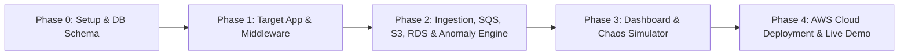

# 🚀 Project Roadmap & Execution Plan

## Cloud-Based Web Application Monitoring & Anomaly Detection Platform
*(Cloud Computing Mini-Project)*

---



---

## 📌 Roadmap Overview

| Phase | Title | Key Deliverables | Effort |
| :--- | :--- | :--- | :--- |
| **Phase 0** | **Setup & Database Design** | Clean project structure, environment configuration, PostgreSQL/RDS schema migration. | Day 1 |
| **Phase 1** | **Target App & Telemetry Middleware** | Realistic Express demo app (`/products`, `/order`, `/payment`) + 30-line non-blocking `monitor.js` middleware. | Day 1 |
| **Phase 2** | **Ingestion, SQS, Storage & Anomaly Engine** | Ingestion API, AWS SQS decoupling, AWS S3 log archival, AWS RDS persistence, threshold anomaly detector. | Day 2 |
| **Phase 3** | **Live Web Dashboard & Chaos Simulator** | Single-page UI with real-time health indicator, latency/error charts, incident logs + `simulator.js` CLI tool. | Day 2 |
| **Phase 4** | **AWS Deployment & Final Demo** | EC2 hosting, RDS connection verification, S3/SQS permissions, live viva demonstration script. | Day 3 |

---

## 🔹 Phase 0: Setup & Database Schema Design

### 🎯 Goal:
Establish the lean project structure and define the database schema on PostgreSQL (supporting both local dev and Amazon RDS).

### 📋 Action Items:
1. **Repository Structure**:
   ```text
   anomaly-detection/
   ├── target-app/        # Sample application to monitor (Port 3000)
   ├── monitor-server/    # Ingestion API, SQS Worker, RDS/S3 persistence & Dashboard UI (Port 5000)
   ├── simulator.js       # Chaos traffic generator script
   └── schema.sql         # Database schema for RDS (PostgreSQL/MySQL)
   ```
2. **Database Schema Design (`schema.sql`)**:
   - `telemetry_logs`: Request-level records (`id`, `timestamp`, `endpoint`, `method`, `status_code`, `latency_ms`).
   - `metrics`: Aggregated snapshots (`id`, `timestamp`, `request_count`, `avg_latency`, `error_rate`).
   - `incidents`: Detected anomalies (`id`, `timestamp`, `type`, `severity`, `endpoint`, `value`, `threshold`, `status`).
3. **Environment Setup (`.env`)**:
   - RDS host, credentials, database name.
   - AWS SQS Queue URL, AWS S3 Bucket name, AWS Region.

---

## 🔹 Phase 1: Target App & Telemetry Middleware

### 🎯 Goal:
Build a realistic target web application and the lightweight telemetry middleware.

### 📋 Action Items:
1. **Target E-Commerce API (`target-app/server.js`)**:
   - `GET /api/products`: Fast catalog response (~20–50ms).
   - `POST /api/order`: Standard checkout route (~100ms).
   - `POST /api/payment`: Heavy route that can be injected with latency (~2000ms+) or failures.
   - `POST /api/login`: Standard authentication endpoint.
2. **Telemetry Middleware (`target-app/monitor.js`)**:
   - Intercepts requests, records start timestamp.
   - On response finish: calculates latency (`Date.now() - startTime`), captures status code, HTTP method, and endpoint.
   - Sends telemetry payload to `http://localhost:5000/api/telemetry` via non-blocking asynchronous HTTP POST.
   - Graceful fallback: If the monitoring server is offline, the target application continues serving requests without interruption.

---

## 🔹 Phase 2: Ingestion API, SQS Pipeline, Storage & Anomaly Detection

### 🎯 Goal:
Build the core monitoring engine: receive telemetry, buffer in AWS SQS, process asynchronously, archive raw logs in S3, persist structured data in RDS, and detect anomalies.

### 📋 Action Items:
1. **Ingestion Endpoint (`monitor-server/api.js`)**:
   - `POST /api/telemetry`: Validates payload and immediately publishes message to AWS SQS (decoupling ingestion from processing).
2. **SQS Worker (`monitor-server/worker.js`)**:
   - Consumes messages from AWS SQS in batches.
   - Deletes processed messages from SQS.
3. **Dual-Tier Storage**:
   - **AWS RDS**: Inserts structured records into `telemetry_logs` and updates current `metrics`.
   - **AWS S3**: Batches raw telemetry logs and periodically writes JSON files to S3 bucket (`s3://<bucket-name>/raw-logs/YYYY-MM-DD/...`).
4. **Threshold Anomaly Detection Logic**:
   - **High Latency Alert**: Triggered when endpoint response time exceeds $1500\text{ ms}$ (SLA violation).
   - **Server Error Spike**: Triggered when HTTP 5xx responses occur or error rate exceeds $10\%$.
   - **Traffic Surge Alert**: Triggered when request volume significantly spikes above standard levels.
   - Saves incident directly to `incidents` table in RDS.

---

## 🔹 Phase 3: Live Dashboard UI & Chaos Traffic Simulator

### 🎯 Goal:
Build the frontend visualization dashboard and the automated traffic generator for easy live demonstrations.

### 📋 Action Items:
1. **Monitoring Dashboard (`monitor-server/public/`)**:
   - Clean, modern single-page dashboard auto-refreshing every 2 seconds.
   - **Real-Time Health Badge**: 🟢 **HEALTHY** (Normal traffic) vs. 🔴 **CRITICAL / ANOMALY DETECTED**.
   - **Live Metric Cards**: Total Requests, Avg Latency ($ms$), 5xx Error Count, Active Incidents.
   - **Time-Series Charts**: Latency trend line and Request Throughput graph (via Chart.js).
   - **Active Incidents Table**: Lists anomaly type, affected endpoint, observed metric value vs threshold, and timestamp.
2. **Traffic Simulator (`simulator.js`)**:
   - CLI tool with 3 clear modes for demonstrations:
     * `node simulator.js normal` $\to$ Sends regular requests to `/products` and `/order` (System stays 🟢 Green).
     * `node simulator.js slow` $\to$ Hits `/payment` with high artificial delay (Dashboard alerts 🔴 Red - *High Latency*).
     * `node simulator.js error` $\to$ Hits broken endpoints triggering HTTP 500 errors (Dashboard alerts 🔴 Red - *Server Error Spike*).

---

## 🔹 Phase 4: AWS Cloud Deployment & Live Viva Demonstration

### 🎯 Goal:
Deploy the monitoring server to AWS EC2, connect to AWS RDS, S3, and SQS, and rehearse the final evaluation demo.

### 📋 Action Items:
1. **AWS Infrastructure Setup**:
   - **Amazon EC2**: Launch Free-Tier `t2.micro` or `t3.micro` Ubuntu instance to host `monitor-server`.
   - **Amazon RDS**: Launch Free-Tier PostgreSQL or MySQL instance (`db.t3.micro` / `db.t4g.micro`, Single-AZ, 20GB).
   - **Amazon SQS**: Create standard telemetry queue (`telemetry-queue`).
   - **Amazon S3**: Create raw logs bucket (`telemetry-raw-logs`).
   - **Security Groups**: Configure RDS inbound rule to permit traffic on port 5432/3306 from the EC2 security group.
2. **End-to-End Live Demonstration Script**:
   1. Show clean, green dashboard with zero incidents.
   2. Run `node simulator.js normal` to show steady incoming requests flowing through SQS to RDS.
   3. Trigger `node simulator.js slow` $\to$ Point to dashboard turning RED with the exact latency alert and affected endpoint.
   4. Show the AWS SQS management console with messages being consumed.
   5. Show the AWS S3 console with uploaded raw JSON log archives.
   6. Show the AWS RDS database containing structured tables (`telemetry_logs`, `incidents`).
